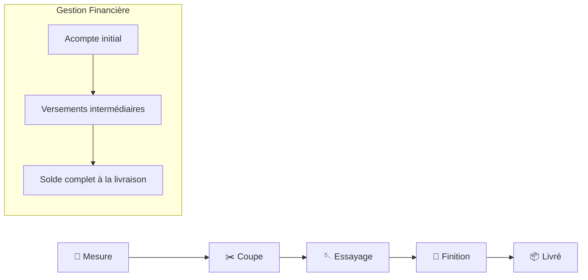

# ✂️ DigitSagnse — Gestion d'Atelier de Couture & Suivi Client

[](https://flutter.dev)
[](https://dart.dev)
[](https://firebase.google.com)
[](https://flutter.dev)
[]()
[]()

> **DigitSagnse** (du mot wolof *« Sañse »*, symbolisant l'art de l'élégance et de la parure vestimentaire) est une solution mobile et multiplateforme complète conçue pour digitaliser, simplifier et moderniser la gestion quotidienne des ateliers de couture et maisons de mode artisanales ou sur mesure.

---

## 📋 Table des Matières

1. [🌟 Présentation du Projet](#-présentation-du-projet)
2. [✨ Fonctionnalités Principales](#-fonctionnalités-principales)
   - [Espace Tailleur](#-espace-tailleur)
   - [Espace Client (Portail Autonome)](#-espace-client-portail-autonome)
3. [🔄 Cycle de Vie d'une Commande](#-cycle-de-vie-dune-commande)
4. [🛠️ Architecture Modulaire & Stack Technologique](#️-architecture-modulaire--stack-technologique)
5. [📁 Structure du Projet (Organisation des Fichiers)](#-structure-du-projet-organisation-des-fichiers)
6. [📊 Modèle de Données](#-modèle-de-données)
7. [🚀 Installation et Démarrage](#-installation-et-démarrage)
   - [Prérequis](#prérequis)
   - [Étapes d'installation](#étapes-dinstallation)
   - [Exécution des tests](#exécution-des-tests)
   - [Configuration Firebase](#configuration-firebase)
8. [🔑 Données de Démonstration](#-données-de-démonstration)
9. [👩‍💻 Auteur & Contributeurs](#-auteur--contributeurs)

---

## 🌟 Présentation du Projet

## 🌟 Présentation du Projet

Dans les ateliers de couture traditionnels, la gestion sur carnet papier (mesures, commandes, acomptes) entraîne souvent des retards, des oublis et des erreurs de suivi.

**DigitSangse** modernise et simplifie le quotidien des tailleurs et de leurs clients grâce à :

* **Gestion des mesures** : Enregistrement précis des mesures morphologiques (Homme/Femme).
* **Suivi de confection** : Progression transparente de la commande en 5 étapes.
* **Rappels automatiques** : Détection et notifications des rendez-vous à J-1.
* **Gestion financière** : Calcul automatique des acomptes et des soldes.
* **Accès adapté** : 
  * **Côté Tailleur** : Tableau de bord complet de gestion.
  * **Côté Client** : Portail dédié pour suivre ses commandes sans mot de passe.

---

## ✨ Fonctionnalités Principales

### 🧵 Espace Tailleur
Un véritable outil de gestion  pour piloter l'atelier de bout en bout :

* **Tableau de Bord & Synthèse** : Vues d'ensemble sur le nombre de clients, commandes actives, trésorerie à recouvrir (FCFA) et alertes pour les rendez-vous du lendemain.
* **Fiches Clients & Mesures Adaptatives** :
  * **Homme** : Poitrine, Épaule, Fesses, Col, Boubou, Pantalon, Manche, Ceinture.
  * **Femme** : Poitrine, Épaule, Taille, Fesses, Blouse, Robe ou Jupe + Boubou.
* **Gestion des Commandes & Photos** : Rattachement au client, photo du modèle, type de tissu, suivi par statut (*Mesure* ➔ *Coupe* ➔ *Essayage* ➔ *Finition* ➔ *Livré*).
* **Planification & Rappels** : Programmateur d'essayages/retraits avec rappels automatiques à J-1.
* **Suivi Financier & Encaissements** : Gestion des paiements échelonnés (Espèces, Wave, Orange Money) et calcul automatique du solde restant.
* **Profil Atelier** : Personnalisation de la maison de couture et synchronisation en temps réel sur Cloud.

### 📱 Espace Client (Portail Autonome)
Une interface fluide pensée pour l'expérience du client :

* **Accès Simplifié** : Connexion rapide via le numéro de téléphone (sans mot de passe).
* **Suivi en Temps Réel** : Progression visuelle de la confection et aperçu de la photo du modèle.
* **Transparence & Rappels** : Consultation des dates de rendez-vous et état exact des paiements (acompte versé / reste à régler).
---

## 🔄 Cycle de Vie d'une Commande



---

## 🛠️ Architecture Modulaire & Stack Technologique

Le projet a été restructuré selon les principes de la **programmation modulaire** et de la séparation des préoccupations. Le code est découpé en modules autonomes et hautement réutilisables :

| Couche / Module | Rôle & Responsabilité | Emplacement |
| :--- | :--- | :--- |
| **Point d'entrée & Init** | Initialisation de Firebase, synchronisation cloud et démarrage | `lib/main.dart`, `lib/app.dart` |
| **Core (Transversal)** | Thème sombre de luxe, constantes métier, widgets personnalisés, helpers de dates | `lib/core/` (`theme/`, `constants/`, `widgets/`, `utils/`) |
| **Data & State** | État global partagé en mémoire, sélecteurs de rendez-vous imminents | `lib/data/app_state.dart` |
| **Models (Métier)** | Entités Dart typées avec sérialisation/désérialisation Firestore et JSON | `lib/models/models.dart` |
| **Services (Cloud)** | Couche Firestore NoSQL (CRUD, transactions de paiement, flux temps réel) | `lib/services/firestore_service.dart` |
| **Screens (Présentation)**| Écrans et interfaces découpés par domaine (Auth, Client, Tailleur, Commandes) | `lib/screens/` |

### Stack Technologique

| Composant | Technologie | Description |
| :--- | :--- | :--- |
| **Langage** | [Dart 3.x](https://dart.dev) | Typage fort, null safety, asynchronisme |
| **Framework Mobile** | [Flutter 3.x](https://flutter.dev) | Rendu multiplateforme natif à 60/120 fps |
| **Base de Données** | [Cloud Firestore](https://firebase.google.com/docs/firestore) | Base NoSQL temps réel avec synchronisation locale |
| **Initialisation Cloud**| [Firebase Core](https://pub.dev/packages/firebase_core) | Intégration unifiée multiplateforme |
| **Médias & Images** | [image_picker](https://pub.dev/packages/image_picker) | Capture photo caméra & sélection galerie |
| **Design System** | Dark Luxury UI | Palette sombre (`#0D0F17`, `#161A26`) avec accents orange couture (`#FF6B35`) |

---

## 📁 Structure du Projet (Organisation des Fichiers)

L'arborescence ci-dessous illustre le découpage modulaire complet de l'application :

```text
couture/
├── android/                             # Configuration native Android (build.gradle, google-services.json)
├── ios/                                 # Configuration native iOS
├── web/                                 # Configuration pour déploiement Web
├── lib/
│   ├── main.dart                        # Initialisation Firebase, sync des listes et bootstrap de l'app
│   ├── app.dart                         # Configuration racine MaterialApp et association du thème
│   ├── firebase_options.dart            # Paramètres de configuration multiplateforme Firebase
│   │
│   ├── core/                            # Couche transversale & partagée
│   │   ├── constants/
│   │   │   └── app_constants.dart       # Listes des mensurations (Homme/Femme) et étapes de fabrication
│   │   ├── theme/
│   │   │   └── app_theme.dart           # Palette de couleurs (kBg, kCard, kOrange) et thème global
│   │   ├── utils/
│   │   │   └── date_utils.dart          # Formateur lisible de dates et heures (ex: "Lun 12/04 à 15:30")
│   │   └── widgets/
│   │       └── custom_widgets.dart      # kGradientButton, kInputDec et composants partagés
│   │
│   ├── data/
│   │   └── app_state.dart               # Données partagées en mémoire (mock/cache) et helpers de rendez-vous
│   │
│   ├── models/
│   │   └── models.dart                  # Modèles de données : Tailleur, Client, Commande, RendezVous, Paiement
│   │
│   ├── services/
│   │   └── firestore_service.dart       # CRUD Firestore, transactions financières, requêtes et synchronisation
│   │
│   └── screens/                         # Interfaces utilisateur découpées par fonctionnalité
│       ├── role_selection_screen.dart   # Écran d'accueil pour choisir : Espace Tailleur ou Espace Client
│       │
│       ├── auth/                        # Authentification & Inscription
│       │   ├── tailleur_login_screen.dart   # Connexion tailleur par email et mot de passe
│       │   ├── tailleur_signup_screen.dart  # Inscription tailleur en 2 étapes (Atelier & Identifiants)
│       │   └── client_login_screen.dart     # Accès client simplifié par numéro de téléphone
│       │
│       ├── client/                      # Espace réservé aux clients
│       │   └── client_portal_screen.dart    # Suivi d'avancement des commandes, photo modèle et rappels
│       │
│       ├── tailleur/                    # Espace réservé aux tailleurs
│       │   ├── tailleur_home_screen.dart    # Conteneur principal avec barre de navigation à onglets
│       │   └── tabs/
│       │       ├── accueil_tab.dart         # Dashboard : indicateurs clés, trésorerie et alertes J-1
│       │       ├── commandes_tab.dart       # Suivi de confection, filtres par statut et raccourcis
│       │       ├── clients_tab.dart         # Répertoire des clients, recherche et accès fiches
│       │       └── mon_atelier_tab.dart     # Profil atelier, informations de contact et déconnexion
│       │
│       ├── clients/                     # Gestion des clients et mensurations
│       │   ├── add_client_screen.dart       # Formulaire de création/édition et prise de mesures dynamique
│       │   └── client_detail_screen.dart    # Vue 360° client : mesures, commandes, RDV et versements
│       │
│       └── commandes/                   # Gestion des commandes de couture
│           └── add_commande_screen.dart     # Formulaire de commande avec sélection photo (caméra/galerie)
│
├── test/
│   └── widget_test.dart                 # Test automatisé de rendu de l'écran initial (smoke test)
├── pubspec.yaml                         # Dépendances et métadonnées du projet
└── README.md                            # Documentation complète du projet
```

---

## 📊 Modèle de Données

Le projet repose sur 5 entités interconnectées définies dans `lib/models/models.dart` :

1. **`Tailleur`** : Propriétaire de l'atelier (`id`, `nom`, `maisonCouture`, `email`, `telephone`, `motDePasse`).
2. **`Client`** : Client de l'atelier (`id`, `tailleurId`, `nom`, `telephone`, `adresse`, `genre`, `mesures`).
   - Les `mesures` sont stockées sous forme de dictionnaire clé-valeur (ex: `{'poitrine': 95.0, 'longueur boubou': 140.0}`).
3. **`Commande`** : Pièce à confectionner (`id`, `clientId`, `tailleurId`, `modele`, `tissu`, `dateLivraison`, `statut`, `montantTotal`, `acompte`, `photoModele`).
4. **`RendezVous`** : Planning d'essayage ou de livraison (`id`, `commandeId`, `clientId`, `type`, `dateHeure`, `note`).
5. **`Paiement`** : Historique des versements (`id`, `commandeId`, `clientId`, `tailleurId`, `montant`, `date`, `mode`, `note`).

---

## 🚀 Installation et Démarrage

### Prérequis

- [Flutter SDK](https://docs.flutter.dev/get-started/install) (version 3.10 ou supérieure)
- [Dart SDK](https://dart.dev/get-dart) (version 3.0 ou supérieure)
- Un appareil Android/iOS connecté ou un émulateur / simulateur configuré
- Android Studio ou Visual Studio Code avec les extensions Flutter & Dart

### Étapes d'installation

1. **Cloner le dépôt :**
   ```bash
   git clone https://github.com/MameDiarra4/Atelier-de-Couture.git
   cd Atelier-de-Couture
   ```

2. **Installer les dépendances :**
   ```bash
   flutter pub get
   ```

3. **Lancer l'application :**
   ```bash
   flutter run
   ```

### Exécution des tests

Pour vérifier l'intégrité de l'application et valider les widgets :
```bash
flutter test
```

### Configuration Firebase

Pour connecter votre propre instance Firebase :
1. Créez un projet sur la console [Firebase Console](https://console.firebase.google.com/).
2. Activez le service **Cloud Firestore**.
3. Placez le fichier `google-services.json` dans le dossier `android/app/`.
4. Configurez si nécessaire `lib/firebase_options.dart` à l'aide de l'outil [FlutterFire CLI](https://firebase.flutter.dev/docs/overview/#installation) :
   ```bash
   flutterfire configure
   ```

---

## 🔑 Données de Démonstration

L'application intègre des données pré-enregistrées pour tester immédiatement l'expérience utilisateur :

### Compte Tailleur (Démo)
- **Email** : `cheikh@atelier.sn`
- **Mot de passe** : `atelier123`
- **Atelier** : *DigitSagnse Couture*

### Accès Client (Démo)
- **Numéro de téléphone** : `771234567` (Fiche de la cliente *Awa Ndiaye*)

---

## 👩‍💻 Auteurs

Projet développé avec passion par :

- **Mame Diarra NGOM P342384** Et **Astou Diop P342328**  —   


---

<p align="center">
  <b>DigitSagnse</b> — L'excellence et le savoir-faire de la couture africaine à l'ère du digital. ✂️✨
</p>
